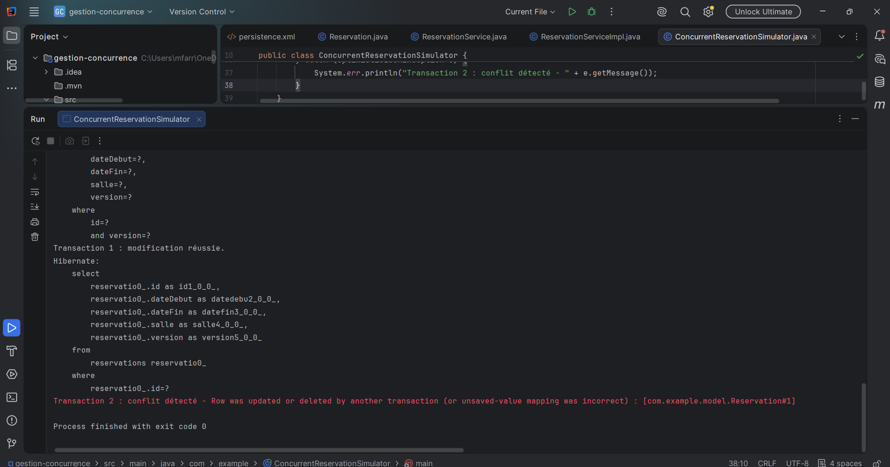
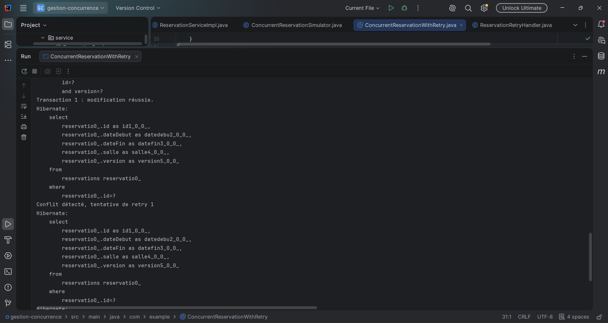
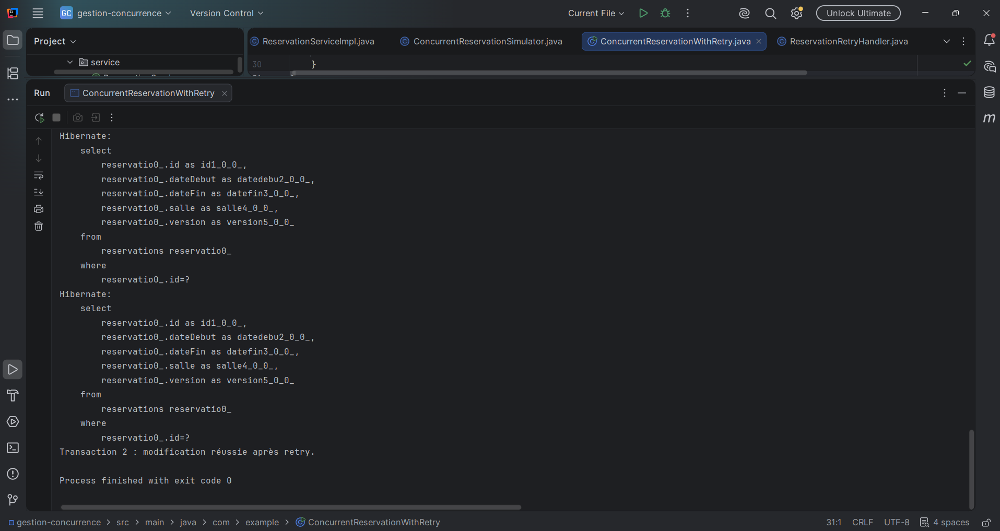

# TP8 : JPA / Hibernate (gestion de la concurrence)

## Description
Projet Maven (JPA, Hibernate 5.4, base H2 en mémoire) illustrant le verrouillage optimiste avec `@Version`.

| Élément | Rôle |
|---|---|
| Reservation | Entité avec un champ `@Version` |
| ReservationService / ReservationServiceImpl | Création, recherche et modification des réservations |
| ConcurrentReservationSimulator | Simule deux transactions concurrentes |

## Principe
- Deux transactions lisent la même réservation (version 0).
- La première modifie et valide : la version passe à 1.
- La seconde tente de modifier avec l'ancienne version : `OptimisticLockException`.

## Configuration
Le fichier `src/main/resources/META-INF/persistence.xml` définit l'unité `reservationPU` (H2 en mémoire, aucune installation nécessaire).

## Exécution
Lancer la classe `com.example.ConcurrentReservationSimulator`.

## Preuves d'exécution

### 1. Création de la table et insertion

### 2. Transaction 1 : modification réussie

### 3. Transaction 2 : conflit détecté

